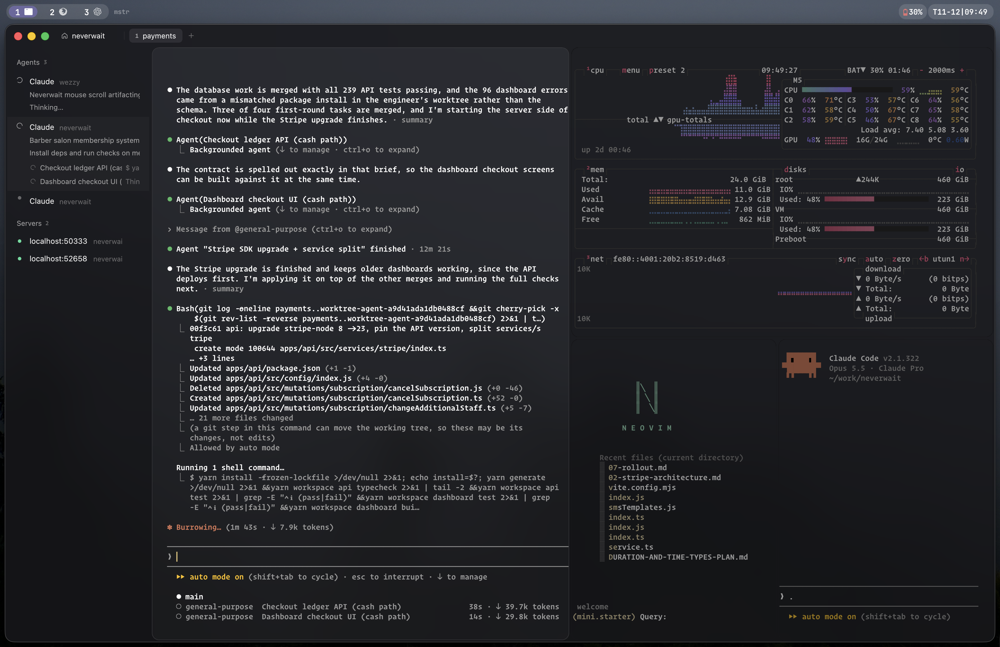

# Wezzy

A terminal-focused home for your AI agents, built keyboard-first.



Run a fleet of Claude Code / pi agents, see at a glance which one is working,
which one needs you, and which one finished while you were getting coffee, then
review, stage, and commit what they did. Everything has a key, so you rarely
need to leave the keyboard.

It's built on WezTerm's engine and reads your WezTerm config as is, so your
keys, leader, plugins and smart-splits come along for the ride. It's named after
WezTerm, out of love and a mild sense of debt.

The mouse works too: click around the sidebar and panels, drag split dividers,
and drop files onto agents.

macOS only for now. Download `Wezzy.dmg` from the
[latest release](https://github.com/schester44/wezzy/releases/latest); it
[updates itself](docs/features/updates.md).

## What you get

- **Agents that report in.** A sidebar lists every agent across every workspace
  with its status: working, needs input, done. A chime when one needs you.
  `Leader 1–9` jumps straight to one.
- **Sessions that survive.** Shells and agents live in a background session
  server. Quit Wezzy, come back, everything's still running.
- **A git panel for reviewing agent work.** Stage hunks, comment on lines, send
  the comments back to the agent, commit. Vim keys, obviously.
- **One palette for everything.** ⌘K finds agents, tabs, workspaces, recipes,
  SSH hosts and commands.
- **Paste and drop images into agents.** Screenshots go straight to Claude / pi.
- **Your WezTerm config, unchanged.** Every WezTerm action works, and Wezzy's own
  actions bind the same way.

## Keys

| | |
|---|---|
| Leader ? | Every key (the leader is ⌃A) |
| ⌘K | Palette (agents, tabs, workspaces, commands) |
| ⌘⇧K | Switch workspace |
| ⌘N | New window |
| ⌘A / ⌘⇧A | New agent in a split / tab |
| Leader 1–9 | Jump to agent 1–9 (numbers show in the sidebar while the leader is armed) |
| ⌘D | Git panel |
| ⌘R | Recipes |
| ⌘⇧S | SSH hosts |
| ⌘E | Editor |
| ⌘B | Sidebar |
| ⌘, | Settings |
| ⌘⇧↵ | Send last output to an agent |
| Leader f | Quick select |
| ⌃h/j/k/l | Move between panes and panels |
| ⌘W / Leader q | Close pane / tab |
| Leader s / v | Split down / right |
| Leader y | Copy mode |
| ? | Shortcut sheet in the git panel |

## Setup

Exact agent status (Claude Code, Codex, pi, OpenCode) needs hooks: ⌘, → Agent hooks.

Config lives in `~/.config/wezzy/` (`wezzy.lua` is WezTerm config, `settings.json` is the rest). Bind app actions like any WezTerm action:

```lua
local ok, wezzy = pcall(require, "wezzy")
if ok then
  table.insert(config.keys, { key = "b", mods = "CMD", action = wezzy.action.ToggleSidebar })
end
```

## Build

```sh
cargo run
scripts/bundle.sh           # Wezzy.app in target/release, for this Mac
scripts/release.sh          # signed + notarized draft release (docs/development/releasing.md)
```

Working on Wezzy inside Wezzy: ⌘K → Rebuild & Restart.

More in [CLAUDE.md](CLAUDE.md) and [docs/](docs/README.md).

Built on [WezTerm](https://github.com/wezterm/wezterm) and [gpui](https://github.com/zed-industries/zed).

MIT licensed; see [LICENSE](LICENSE).
