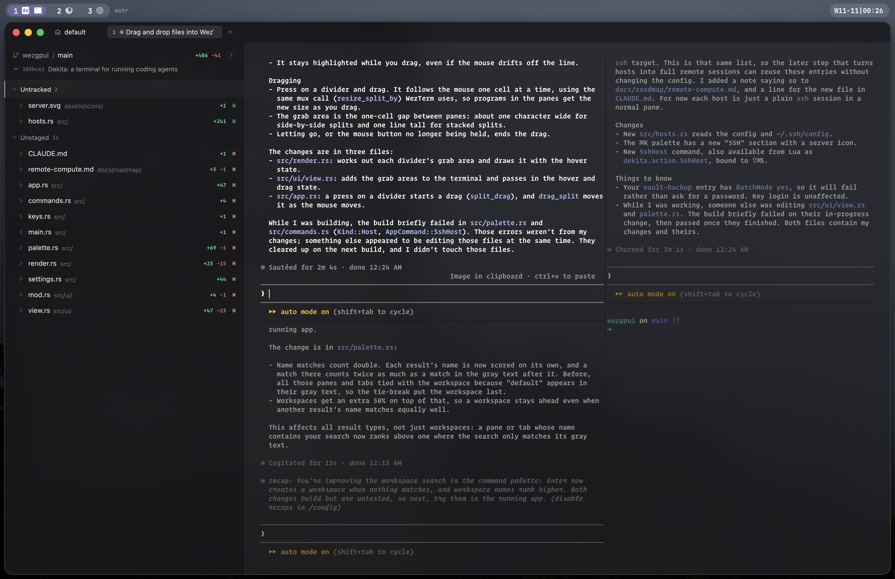

# Wezzy

A terminal-focused home for your AI agents, built for keyboard warriors who
consider reaching for the mouse a moral failing.



Run a fleet of Claude Code / pi agents, see at a glance which one is working,
which one needs you, and which one finished while you were getting coffee, then
review, stage, and commit what they did. All without your hands leaving home row.

It's built on WezTerm's engine and reads your WezTerm config as is, so your
keys, leader, plugins and smart-splits come along for the ride. It's named after
WezTerm, out of love and a mild sense of debt.

**Is Wezzy for you?** If your first reaction to a new app is to look for its
keybindings, yes. If you've ever said "I'll just use the trackpad," Wezzy
respects your choices from a safe distance. Mouse support does exist (you can
drag split dividers and drop files onto agents), but it was added reluctantly
and it knows it.

macOS only for now.

## What you get

- **Agents that report in.** A sidebar lists every agent across every workspace
  with its status: working, needs input, done. A chime when one needs you.
  `Leader 1–9` jumps straight to one.
- **Sessions that survive.** Shells and agents live in a background session
  server. Quit Wezzy, come back, everything's still running.
- **A git panel for reviewing agent work.** Stage hunks, comment on lines, send
  the comments back to the agent, commit. Vim keys, obviously.
- **One palette for everything.** ⌘K finds agents, tabs, workspaces, recipes,
  SSH hosts and commands.
- **Paste and drop images into agents.** Screenshots go straight to Claude / pi.
- **Your WezTerm config, unchanged.** Every WezTerm action works, and Wezzy's own
  actions bind the same way.

## Keys

The important part.

| | |
|---|---|
| ⌘K | Palette (agents, tabs, workspaces, commands) |
| ⌘⇧K | Switch workspace |
| ⌘N / ⌘⇧N | New agent in a split / tab |
| Leader 1–9 | Jump to agent 1–9 (numbers show in the sidebar while the leader is armed) |
| ⌘D | Git panel |
| ⌘R | Recipes |
| ⌘⇧S | SSH hosts |
| ⌘E | Editor |
| ⌘B | Sidebar |
| ⌘, | Settings |
| ⌘⇧↵ | Send last output to an agent |
| ⌃⇧Space | Quick select |
| ⌃h/j/k/l | Move between panes and panels |
| ? | Shortcut sheet in the git panel |

## Setup

Agent status needs the Claude Code hook: ⌘, → Agent hooks → Install.

Config lives in `~/.config/wezzy/` (`wezzy.lua` is WezTerm config, `settings.json` is the rest). Bind app actions like any WezTerm action:

```lua
local ok, wezzy = pcall(require, "wezzy")
if ok then
  table.insert(config.keys, { key = "b", mods = "CMD", action = wezzy.action.ToggleSidebar })
end
```

## Build

```sh
cargo run
scripts/bundle.sh --dmg   # Wezzy.app + dmg in target/release
```

Working on Wezzy inside Wezzy: ⌘K → Rebuild & Restart.

More in [CLAUDE.md](CLAUDE.md) and [docs/](docs/README.md).

Built on [WezTerm](https://github.com/wezterm/wezterm) and [gpui](https://github.com/zed-industries/zed).
